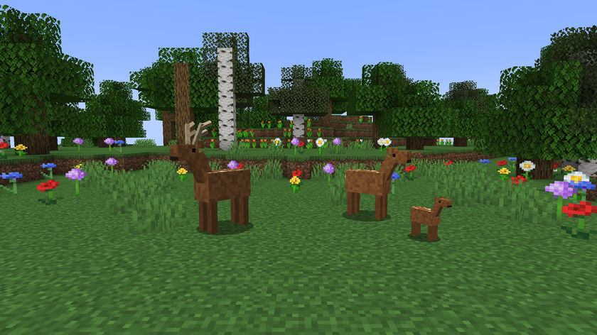
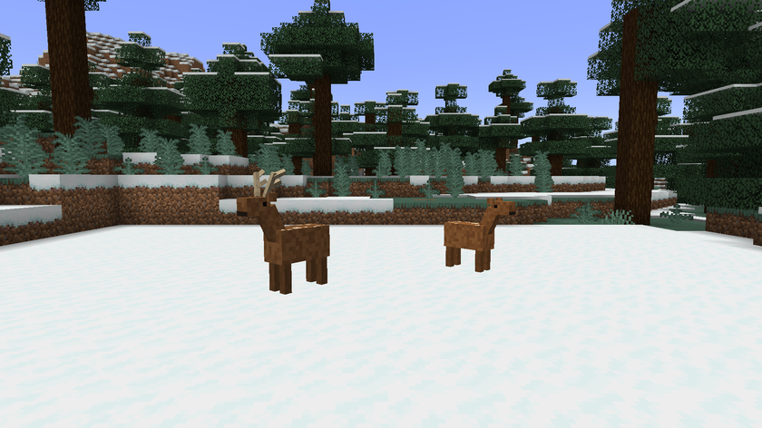
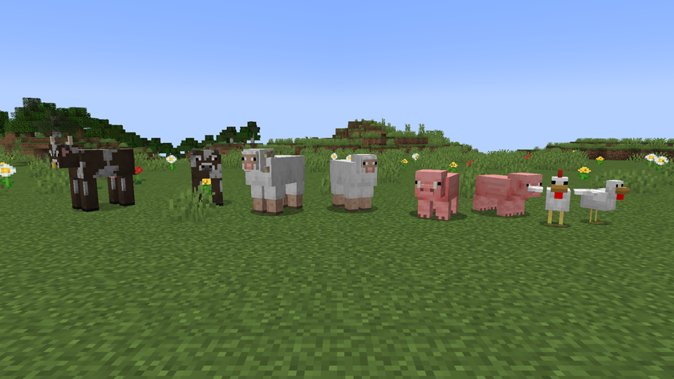
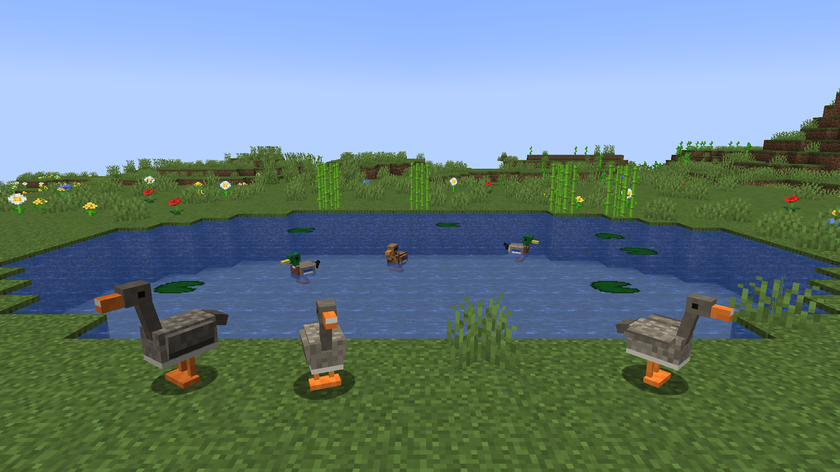
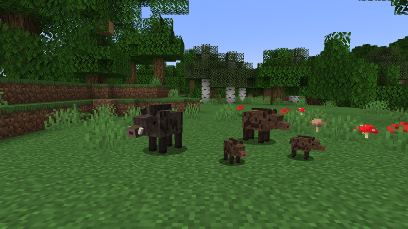

# Animals

[Home](../README.md) · [Guide](guide.md) · **Animals** · [Machines and items](machines.md) · [The world](world.md) · [Recipes](recipes.md)

## The 12 species

<!-- ESPECES -->
| Species | Blocks per animal | Comfort (°C) | Breeding | Gestation | Most young | Life (days) | Wild population | Grazes | Pond |
|---|---|---|---|---|---|---|---|---|---|
| Cow | 10 | -5 to 30 | spring, summer | 2 d | 1 | 40 | 300 | yes | no |
| Pig | 6 | 0 to 30 | all year | 1 d | 3 | 30 | 300 | no | no |
| Sheep | 6 | -10 to 25 | autumn, winter | 2 d | 2 | 35 | 300 | yes | no |
| Chicken | 2 | 5 to 32 | spring, summer, autumn | eggs | 2 | 20 | 400 | no | no |
| Rabbit | 3 | -10 to 28 | spring, summer | 1 d | 4 | 15 | 300 | yes | no |
| Goat | 6 | -15 to 20 | autumn | 2 d | 2 | 35 | 150 | yes | no |
| Deer | 16 | -10 to 25 | autumn | 3 d | 1 | 40 | 120 | yes | no |
| Boar | 12 | -5 to 30 | winter, spring | 2 d | 3 | 35 | 120 | no | no |
| Duck | 3 | 0 to 30 | spring, summer | eggs | 3 | 25 | 200 | no | yes |
| Goose | 4 | -5 to 25 | spring | eggs | 2 | 30 | 150 | yes | yes |
| Dairy Goat | 6 | -5 to 28 | autumn, winter | 2 d | 2 | 35 | 200 | yes | no |
| Ox | 12 | -10 to 30 | spring, summer | 3 d | 1 | 45 | 150 | yes | no |
<!-- /ESPECES -->

Animals from other mods aren't affected.

## Where to find the new species

| Species | Biomes |
|---|---|
| Deer | forests, taigas |
| Boar | forests |
| Duck | rivers, swamps, mangrove swamps |
| Goose | plains, sunflower plains, meadow |
| Dairy Goat | meadow, plains, windswept hills |
| Ox | plains, savanna, meadow |

## Males and females

Each animal's sex is set when it appears. For the six new species, the male and the female each have their own look. The vanilla species change too: bulls get big horns and a nose ring, rams get curled horns, boars get tusks and roosters get a big comb. Adult male cows, pigs, sheep, rabbits and goats are 10% bigger.

An adult male doesn't give milk: the bucket stays empty, with a message. Mooshrooms don't change.

## Age

An animal is young, then adult, then elderly. It turns elderly at three quarters of its life and can no longer breed. It dies of old age at the end of its life, which is 80% to 120% of the value in the table, depending on its vigor gene.

Age and gestation also move forward during a night slept. A baby's growth stays the vanilla one and doesn't move forward during the night.

## Wild, captured, farmed

| Status | What it means |
|---|---|
| Free | It looks after itself. Its food and water slowly drift towards 50 and never hurt it. It doesn't use feeders or troughs and won't breed on command |
| Captured | A wild animal that entered a pen. It has real needs and can breed |
| Farmed | Born to a couple in a pen, or there before the mod was installed and found in a pen |
| Released | A farm animal returned to the wild with the journal |

## Needs and well-being

Well-being goes from 0 to 100%: 30% for space, 25% for food, 25% for water and 20% for comfort.

Space is full when the pen has enough blocks out of the water for all the animals of that species. Comfort is full inside the species' temperature range, and loses 10% per degree outside it.

Hand-feeding something the animal eats gives 35 food points.

## Breeding

When you feed a couple, all of this must be true, otherwise a message explains what's missing:

- a male and a female, not free, not elderly and not sterile
- the female isn't already pregnant
- it's the right season for the species
- the temperature is inside the species' comfort range
- the pen has enough room
- a pond in the pen, for ducks and geese
- at least 60 out of 100 food and water
- at least 50% well-being

After that, the couple waits 5 minutes before it can try again. The number of young goes from 1 to the maximum in the table, depending on the parents' fertility. Birds lay fertilized eggs to put in an [incubator](machines.md).

## Genes

Each animal has five genes. A wild animal starts between 35 and 65.

| Gene | Effect |
|---|---|
| Size | From 70 up, the animal gives 1 more piece of food |
| Speed | Up to 20% more or less speed |
| Yield | Counts for 30% of meat quality |
| Fertility | More young per litter |
| Vigor | Up to 30% more or less health, and a longer or shorter life |

A baby gets the average of its parents, with a bit of chance. It also has a 3% chance of mutation per gene, which adds or removes 15 to 30 points.

## Closely related parents

Close parents lower their babies' vigor and fertility, and can make them sterile.

| Relation | Vigor loss | Fertility loss | Sterility risk |
|---|---|---|---|
| Parent and child, or siblings | 30 | 20 | 40% |
| Another shared ancestor | 15 | 10 | 10% |

## Meat quality

Quality comes 70% from the animal's well-being and 30% from its yield gene. It's kept through cooking. The well-being of a wild animal killed in the open counts as 70 at most.

| Score | Quality | Food |
|---|---|---|
| Under 40 | Poor | 75% |
| 40 to 64 | Normal | 100% |
| 65 to 81 | Good | 125% |
| 82 and up | Excellent | 150% |

## Food

| Food | Raw | Cooked |
|---|---|---|
| Venison | 3 | 8 |
| Boar Meat | 3 | 8 |
| Duck | 2 | 6 |
| Goose | 3 | 7 |

These values are the hunger points given to the player, before quality. Goat Milk gives 3 and Goat Cheese gives 6. A female dairy goat gives a milk bucket, or Goat Milk with a glass bottle. Cheese takes 3 Goat Milk.
