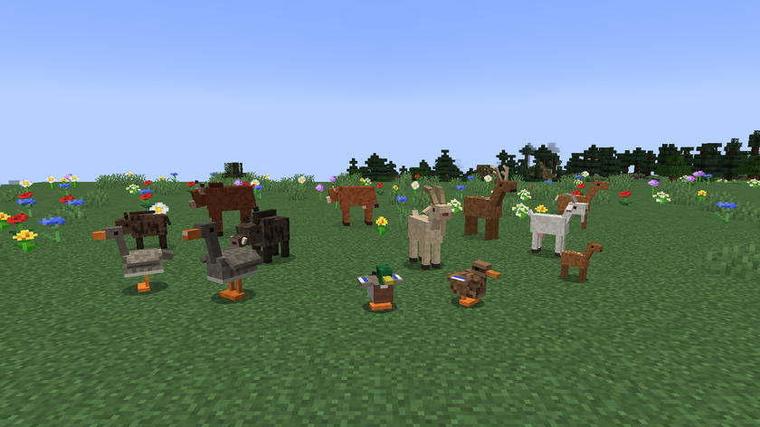

# Guide

[Home](../README.md) · **Guide** · [Animals](animals.md) · [Machines and items](machines.md) · [The world](world.md) · [Recipes](recipes.md)

The mod changes how you raise animals, so here is the simplest order to get started. This is an alpha that nobody has played in a real game yet: back up your world.

## 1. Observe

Craft a [Naturalist's Journal and a Thermometer](recipes.md).

With the journal in hand, look at an animal less than 10 blocks away. The game shows its sex, age and well-being, and notes the species in the journal if it's new. Right-click with the thermometer: the temperature where you stand, the season and the day.

## 2. Build a pen

A pen is an area truly closed by fences, walls or fence gates. An open gate opens the pen, and so does a river, because animals swim across it. A pond inside is fine. The limit is 16,384 blocks, about 128 × 128.

Plan the space: a cow needs 10 blocks, a deer 16, a chicken 2. Each species is counted separately. [The species table](animals.md) has every value.

## 3. Bring the animals in

Lead them in, then untie them once inside: an animal on a lead isn't captured. A free animal is measured every 2 minutes, so capture can take that long.

Once captured, it gets properly hungry and thirsty. If it stays outside any pen for 3 measurements in a row, about 3 minutes, it becomes free again.

## 4. Feed and water

In a pen, food drops by 1 point every 30 seconds and water by 1 point every 20 seconds. If either one reaches 0, the animal loses 1 health point every 30 seconds, until it dies.

- A [feeder](machines.md) feeds the animals in the pen, and a hay bale gives grazers 100 points
- A [water trough](machines.md), or water right next to the animal, lets it drink
- Grazers eat the grass, except in winter, but it takes at least 3 days to grow back

## 5. Get babies

Feed the male and the female as usual. If the couple refuses, a message tells you why: [here are all the conditions](animals.md). Most of the time you have to wait for the right season or feed them first.

Gestation takes 1 to 3 days. A night slept counts towards that time.

## 6. Hatch the eggs

Chickens, ducks and geese lay fertilized eggs. Put them in an [incubator](machines.md) between 30 and 40 °C. It needs one or two campfires next to it. Count on 10 minutes of heat. Keep the fire out of the chicks' reach: they can walk into it and burn.

## 7. Improve your herd

A [syringe and a genetic analyzer](machines.md) read the animals' genes. Good parents and good conditions give [better quality](animals.md) meat. Avoid closely related parents, whose babies are weaker and sometimes sterile.

## 8. Don't empty the wild

Killing wild animals and picking wild plants lowers [their population](world.md). At zero, the species stops appearing. You can still save it with a released farm animal or a seed bank.
