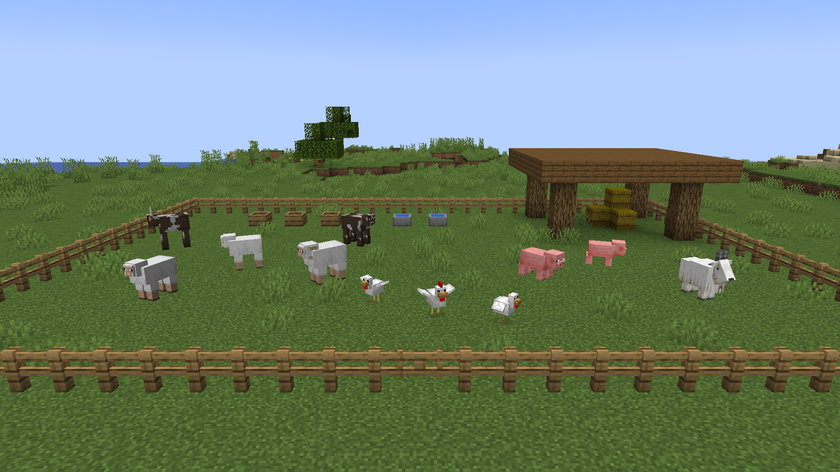
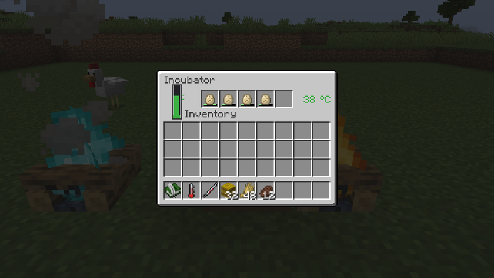
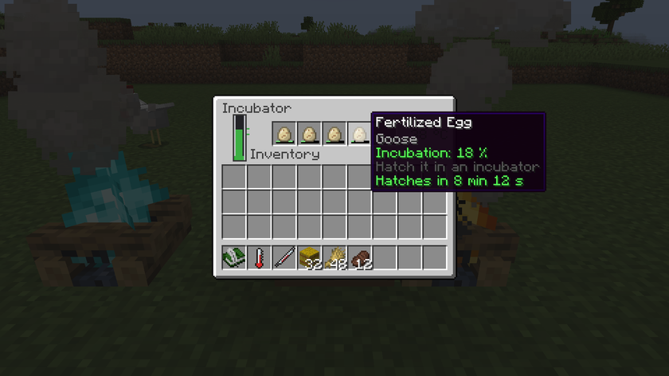
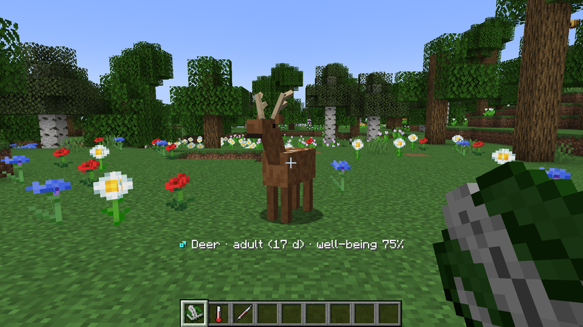
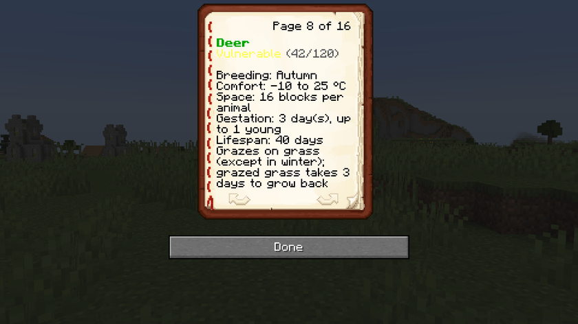
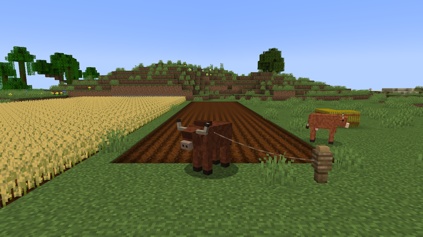

# Machines and items

[Home](../README.md) · [Guide](guide.md) · [Animals](animals.md) · **Machines and items** · [The world](world.md) · [Recipes](recipes.md)

## Feeder

It has 5 slots, and hoppers can fill it. An animal goes to it when its food drops under 60.

- Something the species eats gives 35 points
- A hay bale gives 100 points, to grazers only

An animal in a pen only uses the feeders in its own pen. Outside a pen, it uses those less than 16 blocks away. A free animal never uses them.

## Water trough

It fills up at once with a water bucket, or little by little in the rain. It has 4 levels, and each sip has a 40% chance of taking one away. Access rules are the same as for the feeder.

An animal in a pen can also drink from a water source right next to it.

## Incubator

It has 5 slots and hatches fertilized eggs. Each egg takes 10 minutes of heat, and the baby is born on top of the incubator, or next to it if the top is blocked.

| Temperature | Thermometer | Effect |
|---|---|---|
| Under 30 °C | Blue | Hatching paused |
| 30 to 40 °C | Green | Hatching |
| Above 40 °C | Orange | Hatching stopped |
| Above 45 °C | Red | The egg dies after one minute |

Progress is kept on the egg: taken out, it stops moving, and it picks up where it left off in a heated incubator. Its tooltip shows the percentage, and the time left when it's in the incubator.

To heat it in spring, one test used a campfire touching the incubator and a soul campfire 2 blocks away on the other side. It went over 40 °C around noon, which paused it for a while, without losing an egg. [The world](world.md) gives the power of each heat source.

A night slept doesn't move hatching forward.

**Mind the fire.** A chick can walk into a campfire and burn. It's better to keep the fire away from the babies with a fence, since the heat still gets through.

## Naturalist's Journal

Held in hand, it names the animal you look at less than 10 blocks away and notes new species.

Right-click to read it: season, temperature, then one page per observed species (status, population, season, comfort, space, gestation, life) and the wild plants.

While sneaking, use it on an animal to return it to the wild. It must be an adult, fertile and have at least 50% well-being. The first time a farm animal is released, its wild population gains 3 individuals. A captured animal adds nothing: it already counted.

## Thermometer

Right-click: the temperature here, the season and the day.

## Syringe and samples

Use the syringe on an animal, with an empty sample vial in your inventory: you get a DNA sample. One glass bottle gives 4 empty sample vials.

## Genetic analyzer

It shows the animal's full report in chat: origin, status, needs, age, genes and lineage. There are two ways to use it:

- right-click with a DNA sample
- right-click with an empty hand, with an animal on a lead less than 6 blocks away

## Seed bank

It holds 27 slots of specimens: DNA samples, flowers, sweet berries and mushrooms.

While sneaking with an empty hand, use it to bring back every extinct species it has a specimen of. Each species uses up one specimen and returns at 10% of its maximum population.

## Worn dirt

This is what grass turns into when a kept animal grazes it. It's useless: not for recipes, not for planting, and nearby grass doesn't spread onto it. It turns back into grass after 3 to 4 days, in the light and with nothing solid on top.

## The ox and ploughing

An adult ox on a lead ploughs the grass, dirt and worn dirt under it as it walks, if `mobGriefing` is on. It doesn't plough dirt paths.
