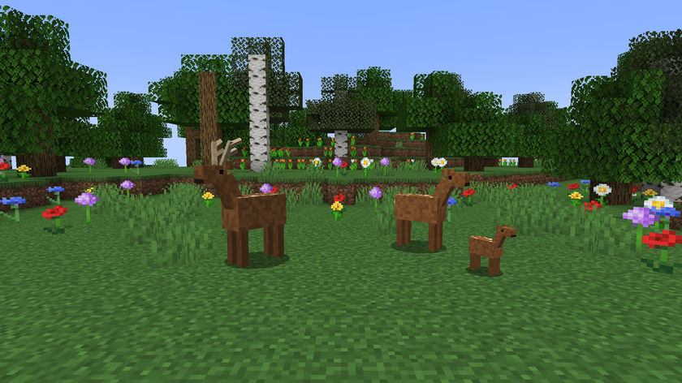
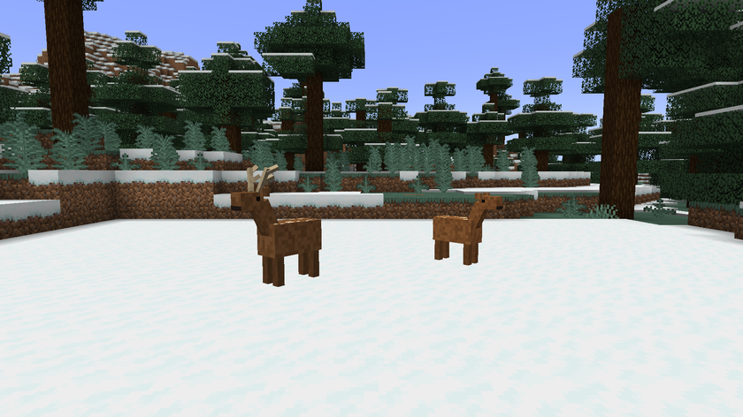
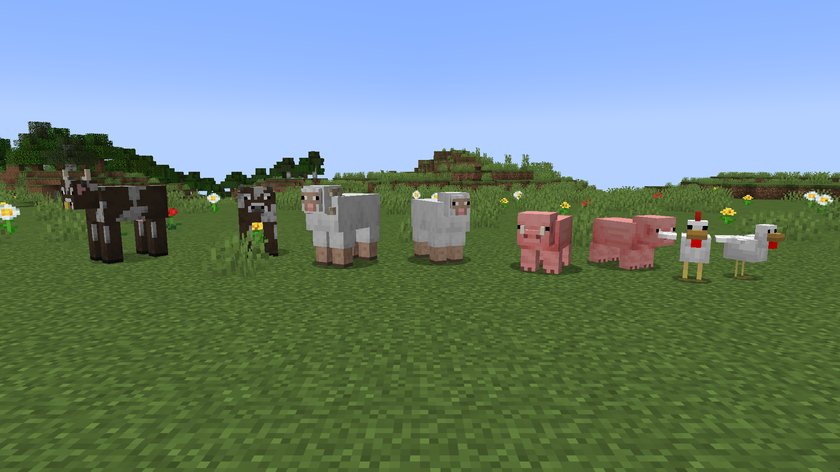
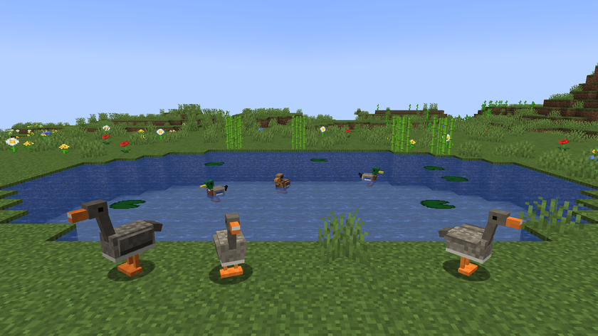
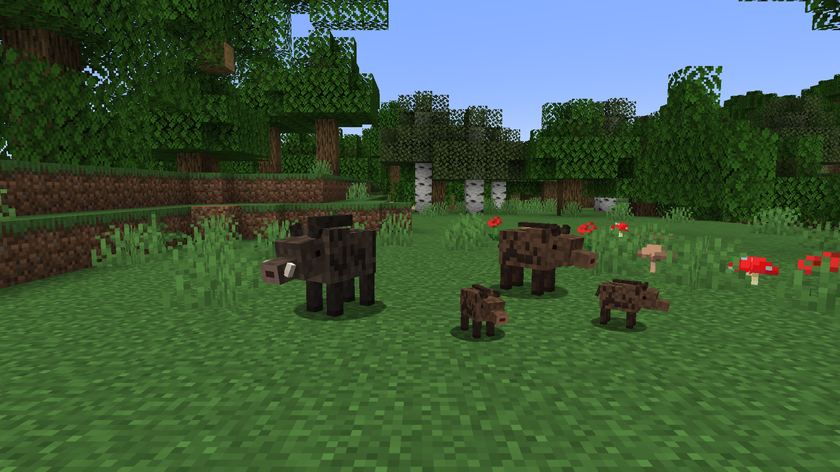

# Les animaux

[Accueil](../README.md) · [Le guide](guide.md) · **Les animaux** · [Machines et objets](machines.md) · [Le monde](monde.md) · [Les recettes](recettes.md)

## Les 12 espèces

<!-- ESPECES -->
| Espèce | Cases par animal | Confort (°C) | Reproduction | Gestation | Petits au plus | Vie (jours) | Population sauvage | Broute | Mare |
|---|---|---|---|---|---|---|---|---|---|
| Vache | 10 | -5 à 30 | printemps, été | 2 j | 1 | 40 | 300 | oui | non |
| Cochon | 6 | 0 à 30 | toute l'année | 1 j | 3 | 30 | 300 | non | non |
| Mouton | 6 | -10 à 25 | automne, hiver | 2 j | 2 | 35 | 300 | oui | non |
| Poule | 2 | 5 à 32 | printemps, été, automne | œufs | 2 | 20 | 400 | non | non |
| Lapin | 3 | -10 à 28 | printemps, été | 1 j | 4 | 15 | 300 | oui | non |
| Chèvre | 6 | -15 à 20 | automne | 2 j | 2 | 35 | 150 | oui | non |
| Cerf | 16 | -10 à 25 | automne | 3 j | 1 | 40 | 120 | oui | non |
| Sanglier | 12 | -5 à 30 | hiver, printemps | 2 j | 3 | 35 | 120 | non | non |
| Canard | 3 | 0 à 30 | printemps, été | œufs | 3 | 25 | 200 | non | oui |
| Oie | 4 | -5 à 25 | printemps | œufs | 2 | 30 | 150 | oui | oui |
| Chèvre laitière | 6 | -5 à 28 | automne, hiver | 2 j | 2 | 35 | 200 | oui | non |
| Bœuf | 12 | -10 à 30 | printemps, été | 3 j | 1 | 45 | 150 | oui | non |
<!-- /ESPECES -->

Les animaux d'autres mods ne sont pas concernés.

## Où trouver les nouvelles espèces

| Espèce | Biomes |
|---|---|
| Cerf | forêts, taïgas |
| Sanglier | forêts |
| Canard | rivières, marais, marais à mangroves |
| Oie | plaines, plaines de tournesols, prairie |
| Chèvre laitière | prairie, plaines, collines venteuses |
| Bœuf | plaines, savane, prairie |

## Mâles et femelles

Le sexe de chaque animal est fixé à son apparition. Pour les six nouvelles espèces, le mâle et la femelle ont chacun leur apparence. Les espèces du jeu de base changent aussi : le taureau a de grandes cornes et un anneau au nez, le bélier des cornes enroulées, le verrat des défenses et le coq une grande crête. Les mâles adultes de la vache, du cochon, du mouton, du lapin et de la chèvre sont 10 % plus grands.

Un mâle adulte ne donne pas de lait : le seau reste vide, avec un message. La mooshroom ne change pas.

## L'âge

Un animal est petit, adulte, puis âgé. Il devient âgé aux trois quarts de sa vie, et ne se reproduit plus. Il meurt de vieillesse à la fin de sa vie, qui va de 80 % à 120 % de la valeur du tableau selon son gène de vigueur.

L'âge et la gestation avancent aussi pendant une nuit dormie. La croissance d'un petit, elle, reste celle du jeu de base et n'avance pas pendant la nuit.

## Sauvage, capturé, d'élevage

| Statut | Ce que ça veut dire |
|---|---|
| En liberté | Il se débrouille seul. Sa faim et sa soif reviennent peu à peu vers 50, sans jamais lui faire de mal. Il n'utilise ni mangeoire ni abreuvoir et ne se reproduit pas sur commande |
| Capturé | Un animal sauvage entré dans un enclos. Il a de vrais besoins et peut se reproduire |
| Élevage | Né d'un couple de l'enclos, ou présent avant l'installation du mod et trouvé dans un enclos |
| Relâché | Un animal d'élevage rendu à la nature avec le carnet |

## Les besoins et le bien-être

Le bien-être va de 0 à 100 % : 30 % pour l'espace, 25 % pour la nourriture, 25 % pour l'eau et 20 % pour le confort.

L'espace est complet quand l'enclos a assez de cases hors de l'eau pour tous les animaux de cette espèce. Le confort est complet dans la plage de température de l'espèce, et perd 10 % par degré en dehors.

Donner à la main un aliment que l'animal mange rend 35 points de faim.

## La reproduction

Quand vous nourrissez un couple, tout ceci doit être vrai, sinon un message explique ce qui manque :

- un mâle et une femelle, ni libres, ni âgés, ni stériles
- la femelle n'attend pas déjà des petits
- c'est la bonne saison pour l'espèce
- la température est dans la plage de confort de l'espèce
- l'enclos a assez de place
- une mare dans l'enclos, pour les canards et les oies
- au moins 60 sur 100 de faim et de soif
- au moins 50 % de bien-être

Ensuite, le couple attend 5 minutes avant de pouvoir recommencer. Le nombre de petits va de 1 au maximum du tableau, selon la fertilité des parents. Les oiseaux pondent des œufs fécondés à mettre en [couveuse](machines.md).

## Les gènes

Chaque animal a cinq gènes. Un animal sauvage part entre 35 et 65.

| Gène | Effet |
|---|---|
| Corpulence | À partir de 70, l'animal donne 1 morceau de nourriture de plus |
| Vitesse | Jusqu'à 20 % de vitesse en plus ou en moins |
| Rendement | Compte pour 30 % dans la qualité de la viande |
| Fertilité | Plus de petits par portée |
| Vigueur | Jusqu'à 30 % de points de vie en plus ou en moins, et une vie plus ou moins longue |

Un petit reçoit la moyenne de ses parents, avec un peu de hasard. Il a aussi 3 % de chances de mutation par gène, qui ajoute ou retire de 15 à 30 points.

## Les parents trop proches

Des parents proches font baisser la vigueur et la fertilité des petits, et peuvent les rendre stériles.

| Parenté | Baisse de vigueur | Baisse de fertilité | Risque de stérilité |
|---|---|---|---|
| Parent et petit, ou frère et sœur | 30 | 20 | 40 % |
| Un autre ancêtre commun | 15 | 10 | 10 % |

## La qualité de la viande

La qualité vient à 70 % du bien-être de l'animal et à 30 % de son gène de rendement. Elle se garde à la cuisson. Le bien-être d'un animal sauvage tué en liberté compte pour 70 au plus.

| Note | Qualité | Nourriture |
|---|---|---|
| Moins de 40 | Médiocre | 75 % |
| 40 à 64 | Normale | 100 % |
| 65 à 81 | Bonne | 125 % |
| 82 et plus | Excellente | 150 % |

## La nourriture

| Aliment | Cru | Cuit |
|---|---|---|
| Venaison | 3 | 8 |
| Viande de sanglier | 3 | 8 |
| Canard | 2 | 6 |
| Oie | 3 | 7 |

Ces valeurs sont les points de faim rendus au joueur, avant la qualité. Le lait de chèvre en rend 3 et le fromage de chèvre 6. Une chèvre laitière femelle donne un seau de lait, ou du lait de chèvre avec une fiole. Le fromage demande 3 laits de chèvre.
