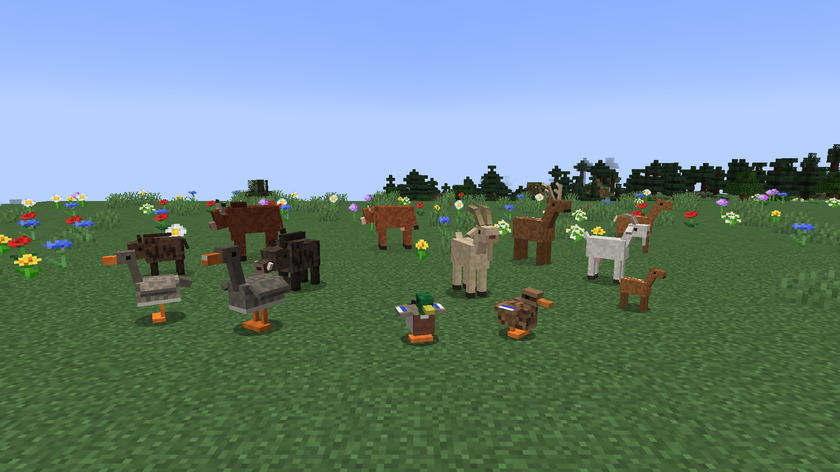

# Le guide

[Accueil](../README.md) · **Le guide** · [Les animaux](animaux.md) · [Machines et objets](machines.md) · [Le monde](monde.md) · [Les recettes](recettes.md)

Le mod change la façon d'élever, alors voici l'ordre le plus simple pour démarrer. C'est une alpha que personne n'a encore jouée en vraie partie : sauvegardez votre monde.

## 1. Observer

Fabriquez un [Carnet du naturaliste et un Thermomètre](recettes.md).

Carnet en main, regardez un animal à moins de 10 blocs. Le jeu affiche son sexe, son âge et son bien-être, et note l'espèce dans le carnet si elle est nouvelle. Clic droit avec le thermomètre : la température à l'endroit où vous êtes, la saison et le jour.

## 2. Construire un enclos

Un enclos est une zone vraiment fermée par des barrières, des murets ou des portillons. Un portillon ouvert ouvre l'enclos, et une rivière aussi, car les animaux la traversent à la nage. Une mare à l'intérieur ne gêne pas. La limite est de 16 384 cases, soit environ 128 × 128.

Prévoyez la place : une vache demande 10 cases, un cerf 16, une poule 2. Chaque espèce se compte à part. [Le tableau des espèces](animaux.md) donne toutes les valeurs.

## 3. Faire entrer les animaux

Amenez-les en laisse, puis détachez-les une fois à l'intérieur : un animal en laisse n'est pas capturé. Un animal libre est mesuré toutes les 2 minutes, donc la capture peut prendre ce temps-là.

Une fois capturé, il a vraiment faim et soif. S'il reste hors de tout enclos pendant 3 mesures de suite, soit environ 3 minutes, il redevient libre.

## 4. Nourrir et abreuver

Dans un enclos, la faim baisse de 1 point toutes les 30 secondes et la soif de 1 point toutes les 20 secondes. Si l'une des deux tombe à 0, l'animal perd 1 point de vie toutes les 30 secondes, jusqu'à en mourir.

- Une [mangeoire](machines.md) nourrit les animaux de l'enclos, une botte de paille rendant 100 points aux herbivores
- Un [abreuvoir](machines.md), ou de l'eau juste à côté de l'animal, le fait boire
- Les herbivores broutent l'herbe, sauf en hiver, mais elle met au moins 3 jours à repousser

## 5. Faire des petits

Donnez à manger au mâle et à la femelle, comme d'habitude. Si le couple refuse, un message dit pourquoi : [voici toutes les conditions](animaux.md). Le plus souvent, il faut attendre la bonne saison ou nourrir les animaux d'abord.

La gestation dure de 1 à 3 jours. Une nuit dormie compte dans ce temps.

## 6. Faire éclore les œufs

Poules, canards et oies pondent des œufs fécondés. Mettez-les dans une [couveuse](machines.md) entre 30 et 40 °C. Il lui faut un ou deux feux de camp à côté. Comptez 10 minutes de chauffe. Gardez le feu hors de portée des poussins : ils peuvent y marcher et brûler.

## 7. Améliorer son élevage

Une [seringue et un analyseur génétique](machines.md) lisent les gènes des animaux. De bons parents et de bonnes conditions donnent une viande de [meilleure qualité](animaux.md). Évitez les parents trop proches, dont les petits sont plus faibles et parfois stériles.

## 8. Ne pas vider la nature

Tuer des animaux sauvages et cueillir des plantes sauvages fait baisser [leur population](monde.md). À zéro, l'espèce n'apparaît plus. Vous pouvez encore la sauver avec un animal d'élevage relâché ou une banque de semences.
