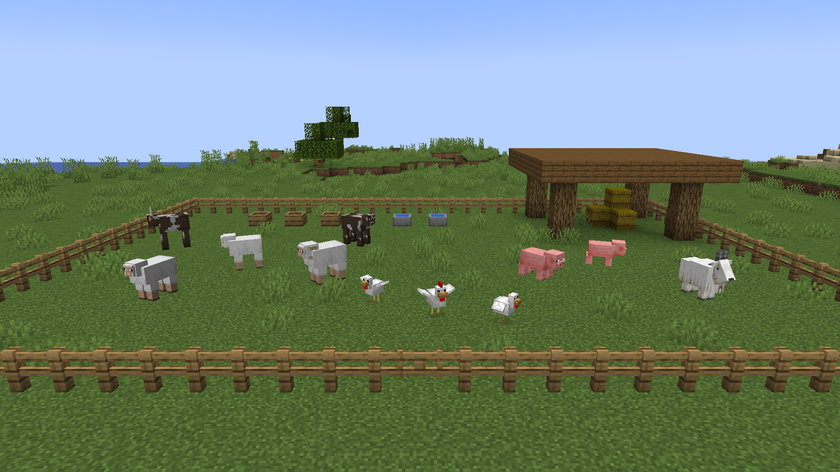
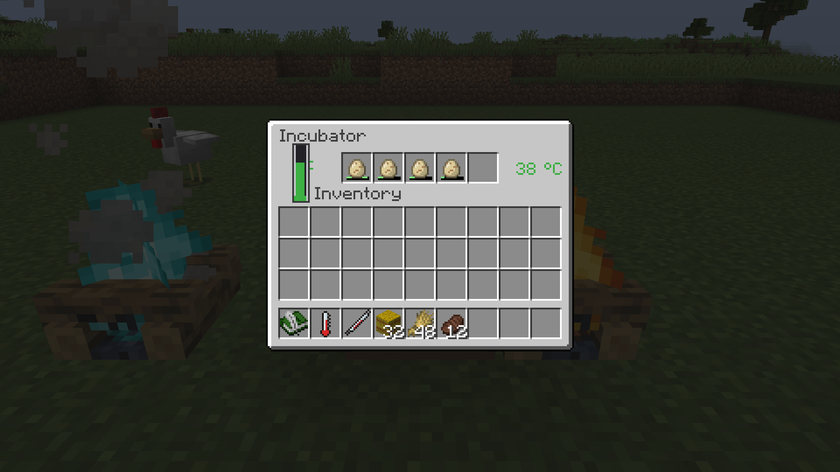
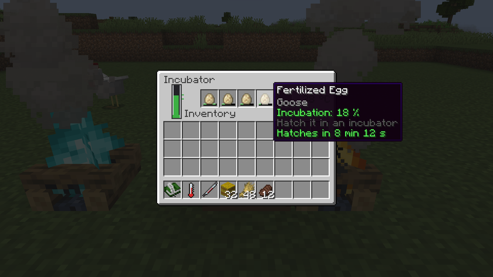
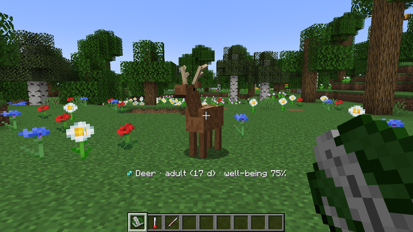
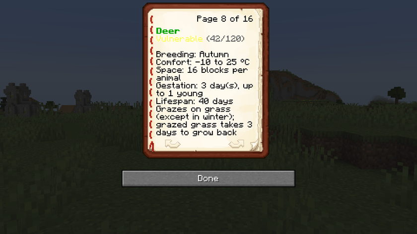
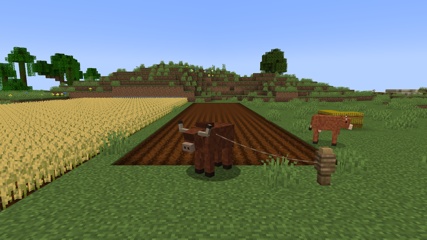

# Machines et objets

[Accueil](../README.md) · [Le guide](guide.md) · [Les animaux](animaux.md) · **Machines et objets** · [Le monde](monde.md) · [Les recettes](recettes.md)

## Mangeoire

Elle a 5 emplacements, et les entonnoirs peuvent la remplir. Un animal y va quand sa faim passe sous 60.

- Un aliment que l'espèce mange rend 35 points
- Une botte de paille rend 100 points, aux herbivores seulement

Un animal dans un enclos n'utilise que les mangeoires de son enclos. Hors enclos, il utilise celles à moins de 16 blocs. Un animal en liberté ne s'en sert jamais.

## Abreuvoir

Il se remplit d'un coup avec un seau d'eau, ou peu à peu sous la pluie. Il a 4 niveaux, et chaque gorgée a 40 % de chances d'en retirer un. Les règles d'accès sont les mêmes que pour la mangeoire.

Un animal d'un enclos peut aussi boire à une eau de source juste à côté de lui.

## Couveuse

Elle a 5 emplacements et fait éclore les œufs fécondés. Il faut 10 minutes de chauffe par œuf, et le petit naît sur la couveuse, ou à côté si le dessus est bouché.

| Température | Thermomètre | Effet |
|---|---|---|
| Moins de 30 °C | Bleu | Éclosion en pause |
| 30 à 40 °C | Vert | Éclosion en cours |
| Au-dessus de 40 °C | Orange | Éclosion arrêtée |
| Au-dessus de 45 °C | Rouge | L'œuf meurt au bout d'une minute |

La progression est gardée sur l'œuf : retiré, il ne bouge plus, et il reprend là où il en était dans une couveuse chauffée. Son infobulle affiche le pourcentage, et le temps restant dans la couveuse.

Pour la chauffer au printemps, un essai a utilisé un feu de camp collé à la couveuse et un feu de camp des âmes à 2 cases de l'autre côté. Elle y a dépassé les 40 °C autour de midi, ce qui l'a mise en pause un moment, sans perdre d'œuf. [Le monde](monde.md) donne la puissance de chaque source de chaleur.

Une nuit dormie ne fait pas avancer l'éclosion.

**Attention au feu.** Un poussin peut marcher dans un feu de camp et brûler. Mieux vaut séparer le feu des petits avec une barrière, la chaleur passant quand même.

## Carnet du naturaliste

Tenu en main, il nomme l'animal regardé à moins de 10 blocs et note les nouvelles espèces.

Clic droit pour le lire : saison, température, puis une page par espèce observée (statut, population, saison, confort, espace, gestation, vie) et les plantes sauvages.

Accroupi, utilisez-le sur un animal pour le rendre à la nature. Il doit être adulte, fertile et avoir au moins 50 % de bien-être. La première fois qu'un animal d'élevage est relâché, sa population sauvage gagne 3 individus. Un animal capturé n'apporte rien : il y comptait déjà.

## Thermomètre

Clic droit : la température ici, la saison et le jour.

## Seringue et échantillons

Utilisez la seringue sur un animal, avec une fiole d'échantillon vide dans l'inventaire : vous obtenez un échantillon d'ADN. Une fiole donne 4 fioles d'échantillon vides.

## Analyseur génétique

Il affiche le rapport complet de l'animal dans le tchat : origine, statut, besoins, âge, gènes et lignée. Deux façons de s'en servir :

- clic droit avec un échantillon d'ADN
- clic droit main vide, avec un animal en laisse à moins de 6 blocs

## Banque de semences

Elle garde 27 emplacements de spécimens : échantillons d'ADN, fleurs, baies sucrées et champignons.

Accroupi et main vide, utilisez-la pour réintroduire toutes les espèces éteintes dont elle a un spécimen. Chaque espèce consomme un spécimen et revient à 10 % de sa population maximale.

## Terre défraîchie

C'est ce que laisse l'herbe broutée par un animal tenu. Elle ne sert à rien : ni aux recettes, ni aux plantations, et l'herbe voisine ne s'y étend pas. Elle redevient de l'herbe au bout de 3 à 4 jours, à la lumière et sans rien de plein au-dessus.

## Le bœuf et le labour

Un bœuf adulte en laisse laboure en marchant l'herbe, la terre et la terre défraîchie sous lui, si `mobGriefing` est activé. Il ne laboure pas les chemins de terre.
